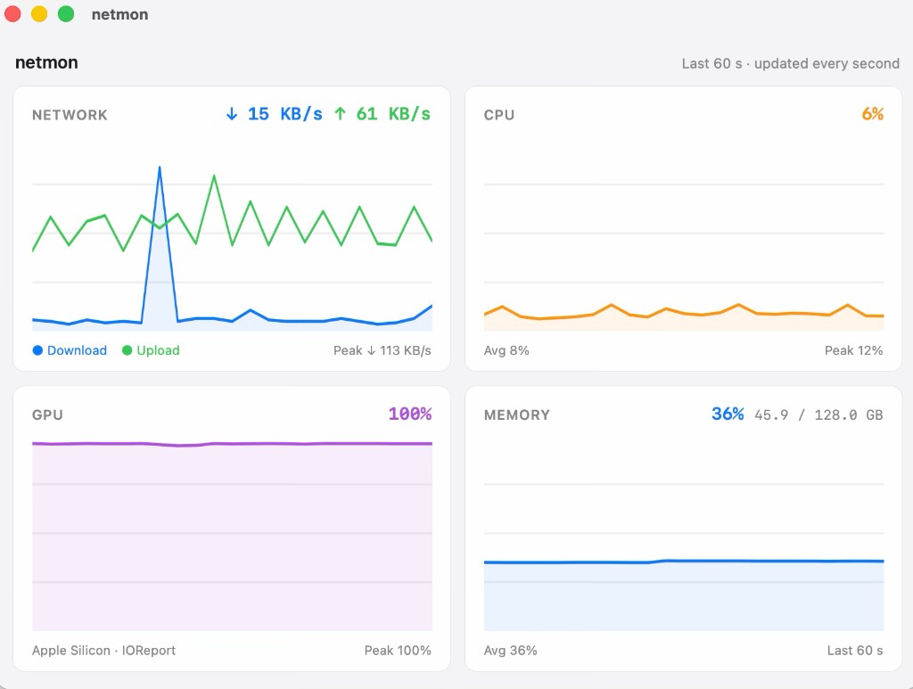

<div align="center">


# netmon

**A lightweight tray app for real-time network, CPU, RAM & GPU monitoring.**

[](https://github.com/j3ffwin5tonone/netmon/releases)
[](https://github.com/j3ffwin5tonone/netmon/actions/workflows/ci.yml)
[](https://github.com/j3ffwin5tonone/netmon/releases)
[](https://github.com/j3ffwin5tonone/netmon/releases)
[](https://tauri.app)
[](package.json)

*Live metrics in the tray — click for a full dashboard with 60-second history.*



</div>

---

## Highlights

- **Tray first** — compact live metrics that stay visible on a crowded menu bar:
  `↓ 12M ↑1.2M  23%  67%  15%`
  - **macOS:** fixed-width text in the menu bar (hover for full units)
  - **Windows:** same metrics in the tray icon tooltip (Windows does not support tray title text)
  - **Linux:** title where the desktop supports it, tooltip as fallback
- **One-click dashboard** — four clean cards with 60-second history charts, updated every second
- **GPU metrics** — Apple Silicon via IOReport (**no `sudo`**); Windows via PDH (same counters as Task Manager, no admin)
- **Tiny footprint** — native Rust backend (Tauri 2), no Electron; system WebView (WKWebView / WebView2)
- **Free & open source** — MIT licensed

## Install

### macOS

Grab the latest `.dmg` from the **[Releases page](https://github.com/j3ffwin5tonone/netmon/releases)**, drag `netmon.app` to Applications, launch — live metrics appear in the menu bar.

If Gatekeeper blocks the first launch: right-click the app → **Open**. On macOS 26 (Tahoe), also enable netmon under **System Settings → Menu Bar** if the extra is missing.

### Windows

Grab the latest NSIS installer (`netmon_*_x64-setup.exe`) or MSI from the **[Releases page](https://github.com/j3ffwin5tonone/netmon/releases)** (or from the **Windows Build** GitHub Action artifacts). Install and launch — netmon appears in the system tray.

The installer uses the **system WebView2** runtime (downloaded at install time if missing). That keeps the app small and avoids bundling a private browser engine — no extra runtime cost versus a typical Tauri/Windows app.

> **Note:** On Intel Macs the GPU card shows "n/a". On Apple Silicon and Windows, GPU utilization is shown when the platform sampler initializes successfully.

## Usage

| Action | Result |
|--------|--------|
| **Left-click** tray icon | Open the dashboard window |
| **Right-click** tray icon | Menu → Quit |
| **Hover** tray icon | Show full units (macOS / Linux) or live metrics (Windows) |

## Metrics

| Metric | Source | Notes |
|--------|--------|-------|
| Network | [`sysinfo`](https://crates.io/crates/sysinfo) | Per-interface byte delta per second (loopback excluded) |
| CPU | `sysinfo` | Global usage across all cores |
| RAM | `sysinfo` | Used vs. total memory |
| GPU | [`macmon`](https://github.com/vladkens/macmon) / PDH | Apple Silicon: IOReport; Windows: `\GPU Engine(*)\Utilization Percentage` (Task Manager) |

## Building from source

Requirements: [Node.js](https://nodejs.org/) 18+, [Rust](https://rustup.rs) (stable).

- **macOS:** Xcode Command Line Tools
- **Windows:** [WebView2](https://developer.microsoft.com/en-us/microsoft-edge/webview2/) (usually preinstalled on Windows 10/11), plus Visual Studio C++ build tools for Rust

```bash
git clone https://github.com/j3ffwin5tonone/netmon.git
cd netmon
npm install
npm run tauri dev      # development
npm run tauri build    # release build
```

Quality checks (same as [CI](.github/workflows/ci.yml)):

```bash
npm run check && npm run build
cd src-tauri && cargo fmt --all -- --check && cargo clippy --locked --all-targets -- -D warnings && cargo test --locked --all-targets
```

Artifacts land under `src-tauri/target/release/bundle/`:

- macOS → `macos/` / `dmg/`
- Windows → `msi/` and `nsis/`

CI typechecks the frontend and runs Rust fmt/clippy/tests on Apple Silicon; Windows installers are built on every push via [`.github/workflows/windows.yml`](.github/workflows/windows.yml).

## Architecture

```
netmon/
├── src/                 # SvelteKit frontend (dashboard, charts)
│   └── lib/components/  # NetworkChart, CpuChart, GpuChart, MemoryChart
└── src-tauri/           # Tauri 2 / Rust backend
    └── src/metrics/     # cpu, memory, network, gpu collectors
```

The backend collects a `MetricsSnapshot` every second and emits it to the frontend via the `metrics-update` event. History is a 60-entry ring buffer; GPU sampling runs on a dedicated thread (Apple Silicon and Windows). The menu bar title uses a compact, fixed-width format so macOS does not cull the extra when the bar is full.

## Acknowledgments

[Tauri](https://tauri.app) · [SvelteKit](https://kit.svelte.dev) · [sysinfo](https://crates.io/crates/sysinfo) · [macmon](https://github.com/vladkens/macmon) · [Windows PDH](https://learn.microsoft.com/en-us/windows/win32/perfctrs/about-performance-counters)

## License

MIT
